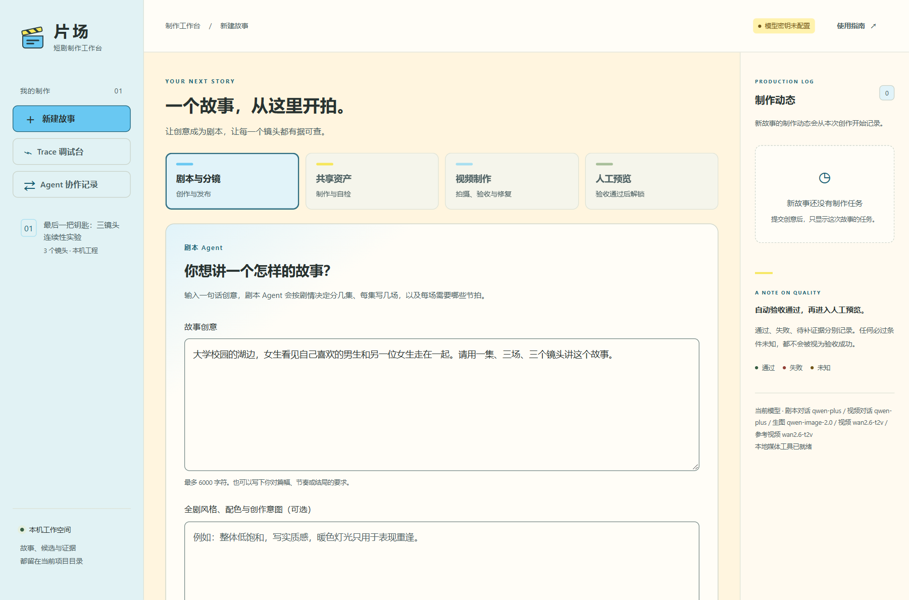
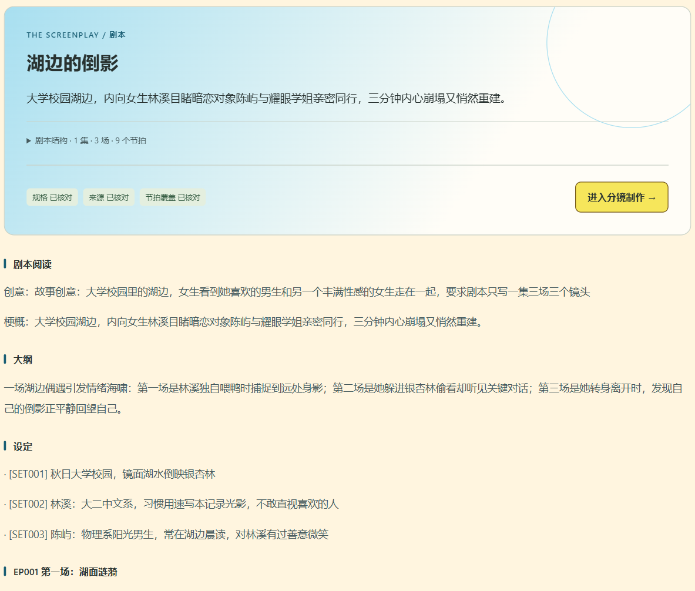
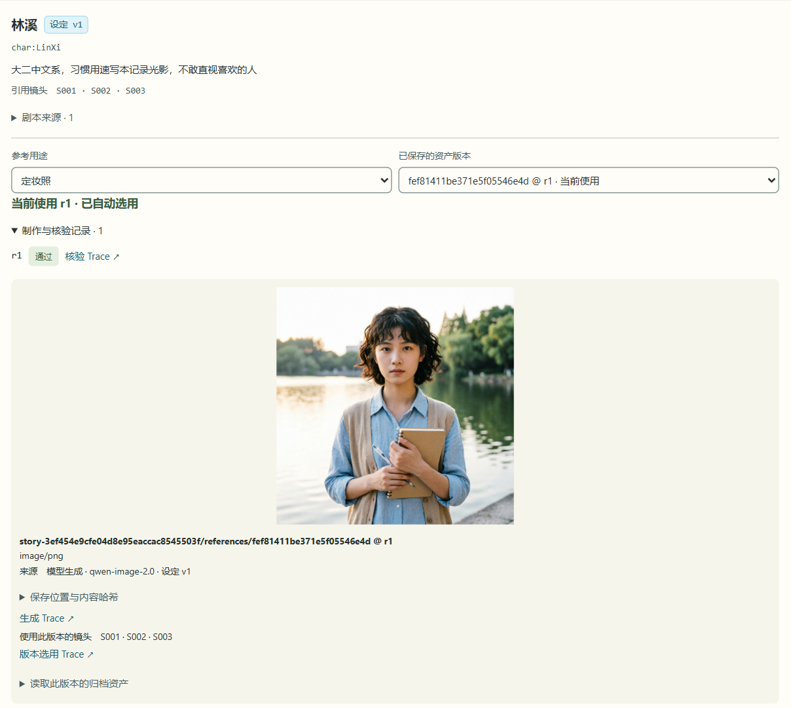
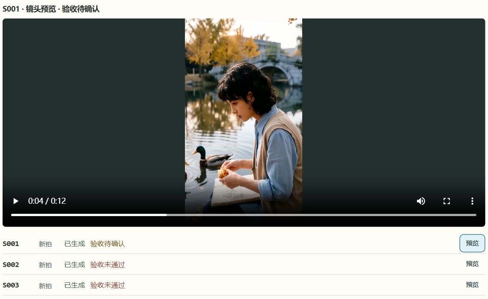
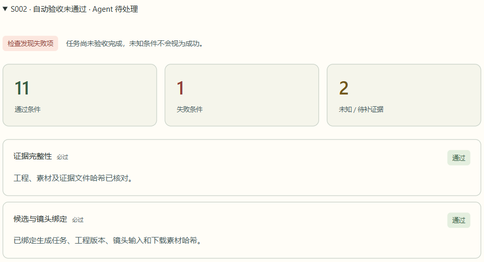
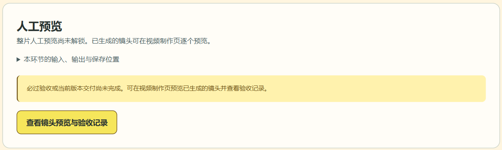
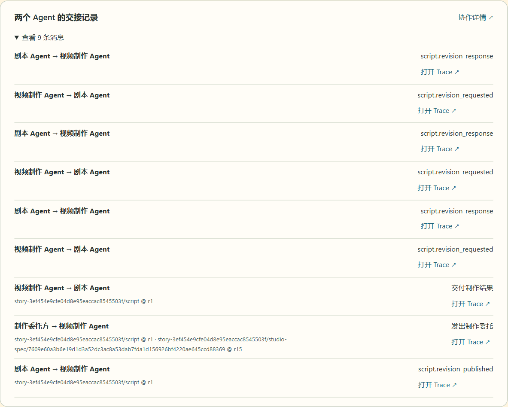
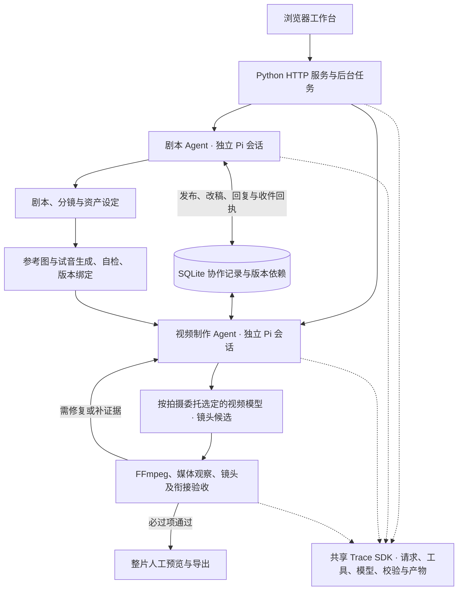

# 片场 - 短剧制作工作台

**一个故事，从这里开拍。**

写下一句创意，剧本 Agent 把它写成能拍的戏，视频制作 Agent 接过分镜、定妆照和试音，逐镜拍摄、验收、修订。你可以坐在同一张工作台前读剧本、看样片，查清女主角在这一镜用了哪版造型，再决定哪里需要重拍。

片场面向 **AI 短剧、AI 视频和 AI 电影创作**。从人物第一次出场，到两个镜头能否剪在一起，每个制作决定都有版本、来处和验收记录。

## 一、跟拍《湖边的倒影》



### 从一句创意，到三个可以拍摄的镜头

> 大学校园的湖边，女生看见自己喜欢的男生和另一位女生走在一起。用一集、三场、三个镜头讲这个故事。

这是《湖边的倒影》原始创意的简写。上图在「新建故事」中演示输入，以下截图取自这个故事已经保存的真实制作记录。

剧本 Agent 给女孩起名林溪，让“误会”在三个地方发生变化。湖边长椅上，她看见陈屿和红裙学姐走过石桥；银杏林里，她听到了两人的对话；最后，她走到浅滩，看见自己的倒影。打开「剧本与分镜」，可以阅读原稿，核对哪些剧情节拍已经落到了镜头上。



### 给演员定妆、留声，把通过的版本交给镜头

剧本里的名字会变成制作资产。《湖边的倒影》的共享资产包括三张人物定妆照、三份试音、三个场景、四件道具和两套服装。这个工程的 **15 项资产都有通过记录**，图库分别标出「已自动选用」和「已人工通过」。点开一个角色，可以看图、听声音、读检查结果，也能看到哪些镜头正在使用它。


林溪的角色 ID 是 `char:LinXi`。她的定妆照 `r1` 通过核验后，被 S001、S002、S003 三个镜头共同引用。打开定妆照详情，就能看到这张图的资产 ID、核验 Trace 和引用它的镜头。想换造型时，可以在原资产下提交修改意见，为下一版保留同一条版本记录。



### 拍三个镜头，逐镜审看到成片交付

视频制作 Agent 按分镜和选定的参考资产组织视频请求。《湖边的倒影》留下了 **S001、S002、S003 三个视频候选**。在工作台打开一个镜头，就可以看片段，并查看这一版的验收结果。



成片要过两道检查：每个镜头符合剧本要求，相邻镜头剪在一起也成立。这个例子恰好展示了验收能发现什么。

| 镜头 | 实际验收结果 | 制作者接下来要处理什么 |
| --- | --- | --- |
| S001 | 待补证据 | 起止状态的 12 项声明中，11 项有证据支持，1 项仍无法确认。 |
| S002 | 未通过 | 剧本写的是林溪躲进银杏林，候选画面里她仍坐在湖边长椅上。起止状态检查失败。 |
| S003 | 未通过 | 动作顺序与道具检查存在问题，需要对照分镜修正。 |

S002 的报告列出 11 项通过、1 项失败、2 项未知。点开失败项，可以对照开头和结尾的时间段、实际画面与使用的参考图。[查看 S002 起止状态的逐项证据截图](docs/images/lake-video-criterion.png)



这个故事目前停在「待交付」。当所有镜头及相邻衔接的必过项通过，工作台才会解锁整片人工预览和导出。下图是《湖边的倒影》实际的交付页。



## 二、片场如何把一组生成结果做成一个工程

**换一张定妆照，哪些镜头受影响？** 资产有稳定的 `asset_id`，新版本有独立的 `revision_id`。每个镜头用 `required_refs` 固定具体版本、人物和用途，同时记录资产与媒体文件的 SHA-256。可以从资产反查镜头，也可以从镜头往回查：分镜要求了什么、请求准备了什么、哪些参考确实提交过。有了这条记录，才知道改稿后哪些素材可以复用。

**视频遇到问题，谁来改剧本？** 剧本 Agent 和视频制作 Agent 各自保存当前故事的上下文，分别使用编剧和制作工具。视频 Agent 可以带着节拍、问题、建议和证据发出改稿请求，剧本 Agent 在自己的会话里答复。《湖边的倒影》的交接面板保留了九条消息，其中包括三轮改稿请求与回复；每条都能打开对应的 Trace。



**怎样决定一个镜头该不该重拍？** 视频 Agent 检查实际片段的人物、道具、动作和衔接。每个镜头验收未通过时最多自动重拍一次。复验仍未通过，控制台会打印失败理由。在「视频制作 → 审看镜头与人工通过」播放当前版本，认可画面后点「人工通过」。所有镜头、相邻衔接及文件检查通过后，即可播放剪好的成片。[镜头制作与人工验收](docs/WORKBENCH_GUIDE.md#启动片场并制作短剧)

## 快速开始（macOS 和 Windows）

下载 ZIP 并**完整解压**。打开能看到 `README.md` 和两个「启动片场」文件的文件夹，以下称为项目目录。[下载片场 ZIP](https://github.com/stock-programmer/set/archive/refs/heads/main.zip)

| 系统 | 第一次打开 |
| --- | --- |
| Windows | 在资源管理器双击 **`启动片场.cmd`**。如果缺少 Python 3.11 或更高版本，可按窗口提示用 winget 安装，或打开 Python 官方下载页。 |
| macOS | 在访达双击 **`启动片场.command`**。缺少 Python 3.11 或更高版本时，按提示打开官方下载页，安装后再次双击。 |

- **先看示例。** 首次启动会从 `.env.example` 创建本机的 `.env`。浏览器打开后选《最后一把钥匙》，即可阅读剧本和已有镜头。
- **使用旧版百炼工程。** 仅有 `.env`、没有 `config/models.json` 的工程沿用原有百炼设置，可在启动窗口填写北京地域 API Key。[获取百炼 API Key](https://help.aliyun.com/zh/model-studio/get-api-key)
- **不同环节用不同模型。** 例如沿用千问写剧本，只把人物定妆照交给 OpenAI，或让带参考素材的镜头使用 Seedance。按下文配置后，在工作台就能核对每一项选中的模型。[配置多个模型和供应商](#配置多个模型和供应商)

在线使用两个 Agent 需要 Node.js 22.19 或更高版本及 npm。配置了任一 Agent 的对话 Key 后，再次双击启动器会检查并按需安装 Pi 依赖。检查媒体和导出成片还需要 FFmpeg、ffprobe。Mac 提示文件无法打开、Windows 找不到 Python，或浏览器未自动打开时，可查看[首次配置与启动排障](docs/WORKBENCH_GUIDE.md#启动与首次配置)。

## 配置多个模型和供应商

### 1. 填写供应商密钥

用文本编辑器打开项目目录的 `.env`。如果还没启动过片场，可先复制 [.env.example](.env.example) 并命名为 `.env`。保留已有设置，在等号右边填写自己要用的 Key。启用自定义连接后，若启动窗口提示「部分用途尚缺密钥」，就在这个文件里补填。Mac 访达可按 `Command + Shift + .` 显示隐藏文件。Windows 保存时确认文件名是 `.env`，没有附加 `.txt`。

```dotenv
DASHSCOPE_API_KEY=
OPENAI_API_KEY=
GEMINI_API_KEY=
ARK_VIDEO_API_KEY=
```

项目当前的 [models.json](config/models.json) 使用火山方舟 Seedream 5.0 Pro（`doubao-seedream-5-0-pro-260628`）生成人物、场景和道具参考图，Seedance 2.0 mini 生成镜头，两者共用 `ark-production` 连接。OpenAI 负责剧本、制作决策、声音和验收。填写 `OPENAI_API_KEY` 和 `ARK_VIDEO_API_KEY` 后，在页面顶部的密钥状态查看各用途、模型和配置状态。同名系统环境变量优先于 `.env`。密钥状态只表示片场读到了值，模型权限由实际调用确认。

只用百炼时也可以在 `.env` 换型号。`BAILIAN_TEXT_MODEL` 设置默认文本模型，`BAILIAN_VIDEO_MODEL` 设置普通视频模型，`BAILIAN_REFERENCE_VIDEO_MODEL` 设置带参考素材的视频模型，`BAILIAN_VISION_MODEL` 设置默认视觉观察模型。百炼文本和媒体分别使用 `BAILIAN_TEXT_BASE_URL` 和 `DASHSCOPE_BASE_URL`。使用北京地域时可沿用 [.env.example](.env.example) 的地址。

### 2. 指定每个用途使用哪个模型

片场读取项目目录下的 `config/models.json`。如果要同时配置 Gemini 对话、OpenAI 生图和方舟视频，复制 [models.example.json](config/models.example.json) 到同一文件夹，重命名为 `models.json`，把每个 `your-…` 占位值换成对应账户已开通的模型 ID 或方舟接入点 ID。

**如果只想更换参考图模型**，下面就是一份完整的 `config/models.json`。替换 `your-image-model-id` 后，人物定妆照、场景图和道具图都会使用这个模型。两个 Agent 的对话、视频生成和素材审查仍继承原来的百炼配置。

```json
{
  "version": 1,
  "extends": "bailian",
  "connections": {
    "openai-art": {
      "provider": "openai",
      "account": "studio-openai",
      "base_url": "https://api.openai.com/v1",
      "api_key_env": "OPENAI_API_KEY"
    }
  },
  "models": {
    "gpt-reference-image": {
      "connection": "openai-art",
      "adapter": "litellm",
      "sdk_provider": "openai",
      "model_id": "your-image-model-id"
    }
  },
  "routes": {
    "reference.image": "gpt-reference-image"
  }
}
```

| 配置项 | 应该填什么 |
| --- | --- |
| `version`、`extends` | 使用格式版本 `1`。`"extends": "bailian"` 表示继承百炼设置，`routes` 只写想更换的用途。 |
| `disabled_providers` | 当前为 `["aliyun-bailian"]`。漏配任何仍指向百炼的用途，加载配置会指出该用途。 |
| `connections` | 每个连接起一个名字，如 `openai-art`。`provider` 标记供应商，`account` 是自己给这份账户取的稳定名称。同一供应商有两个账户时，各建一个连接。 |
| `base_url`、`api_key_env` | `base_url` 填供应商提供的 HTTPS API 根地址，保留版本路径，如 `/v1`。`api_key_env` 填上一步的**变量名**，如 `OPENAI_API_KEY`。 |
| `models`、`connection`、`model_id` | 为模型起一个片场内使用的别名，如 `gpt-reference-image`。`connection` 引用上面的连接名，`model_id` 填供应商控制台里的实际型号或接入点 ID。多个模型可以共用一个连接和 Key。 |
| `image_size` | Images 接口的可选输出尺寸。当前 Seedream 5.0 使用 `2048x2048`。 |
| `image_response_format` | 参考图模型的可选返回格式。当前 Seedream 使用 `b64_json`，工作台从生成响应中直接读取原图。支持临时下载链接的接口也可配置 `url`。省略时使用供应商默认格式。 |
| `adapter`、`sdk_provider` | `litellm` 使用项目的 SDK 传输层，并指定协议名 `sdk_provider`。方舟视频用 `volcengine`，OpenAI 对话、生图和语音输出用 `openai`。原生审查接口使用 `adapter: "openai"`；旧百炼工程使用 `adapter: "bailian"`。 |
| `routes` | 左边是片场的用途，右边是已定义的模型别名。要把参考图切回百炼，可以把 `reference.image` 的值改为内置别名 `bailian.image`。 |

| 想更换的环节 | 在 `routes` 中设置 |
| --- | --- |
| 剧本 Agent 对话、视频制作 Agent 对话 | 分别设置 `script.decision`、`video.decision` |
| 人物、道具和场景参考图 | `reference.image` |
| 普通视频、使用固定参考素材的视频 | 分别设置 `video.text_to_video`、`video.reference_to_video` |
| 分镜编译、参考图提示词、声音选角、重拍策略 | 分别设置 `story.compile`、`reference.prompt`、`voice.casting`、`video.repair_strategy` |
| 角色试音、声音验收 | 分别设置 `voice.synthesis`、`voice.review` |
| 图像与镜头画面验收、相邻镜头声画验收 | 分别设置 `vision.review`、`continuity.review` |

更换同一接口下的兼容模型时，修改别名对应的 `model_id`。只改一个用途时，创建新别名并修改对应的 `routes` 项。例如，`video.decision` 可以单独选择视频 Agent 的决策模型。[全部用途与已接协议](docs/MULTI_PROVIDER_MODEL_GATEWAY.md#可配置的用途)

Windows 上，SDK 会使用「设置 → 网络和 Internet → 代理」中已启用的手动代理，并遵守代理例外地址。代理设置变更在下一次请求生效；无需把代理地址写入模型 `base_url`。此接入不执行 PAC 自动配置脚本。[代理接入说明](docs/MULTI_PROVIDER_MODEL_GATEWAY.md)

### 3. 安装 SDK 并确认配置生效

任一用途选用了 `adapter: "litellm"` 时，在**项目目录**打开终端，给运行片场的同一个 Python 安装模型依赖。双击启动器会检查 SDK 版本并提示缺少的依赖。

| 系统 | 首次安装 SDK | 打开工作台 |
| --- | --- | --- |
| Windows | 在项目文件夹的地址栏输入 `powershell` 并回车，运行 `py -3 -m pip install ".[models]"`。如果启动器使用的是 `python` 命令对应的 Python 3.11+，可用 `python -m pip install ".[models]"`。 | 双击 `启动片场.cmd` |
| macOS | 在终端输入 `cd` 和一个空格，把项目文件夹拖入终端并回车，再运行 `python3 -m pip install ".[models]"`。 | 双击 `启动片场.command` |

如果 macOS 的 Python 提示 `externally-managed-environment`，可以在项目目录创建专用环境，并直接用它打开工作台。以后在该目录运行最后一行即可启动。

```bash
python3 -m venv .venv
.venv/bin/python -m pip install ".[models]"
.venv/bin/python -m tools.launch_workbench --configure --open-browser
```

打开或刷新工作台后，**把鼠标放在顶部的密钥状态上**，可逐项查看哪个用途读到了 Key。再到右侧「制作动态」底部看「当前模型」，核对剧本对话、视频对话、生图、视频和参考视频的模型 ID。查看配置无需提交生成任务。实际可用的模型和额度取决于供应商账户，在线生成和模型验收按实际调用计费。

修改 `.env` 或 `config/models.json` 后，先刷新页面核对。若更换了 Python 环境或系统环境变量，再次双击可能复用原后台服务。可以等正在制作的任务结束后重启电脑，再用上表的启动文件或虚拟环境命令打开工作台。[启动与环境排障](docs/WORKBENCH_GUIDE.md#启动与首次配置)

已确认的拍摄委托会保存选定的供应商、账户和模型。切换默认视频模型后，保留原连接及其账户标识和端点，片场才能继续按原任务 ID 查询、下载已经提交的视频。[视频任务恢复](docs/MULTI_PROVIDER_MODEL_GATEWAY.md#保护已确认和已付费的任务)

## 三、技术架构

[MIT 许可证](LICENSE) · 允许商业使用、修改与再分发，分发时须保留版权及许可声明。

### 架构图与模块



| 模块 | 如何实现 |
| --- | --- |
| 工作台与任务 | 本地 HTTP 服务提供剧本、资产、视频、预览四个阶段。耗时制作在后台执行，刷新页面可继续查看。见 [Web 入口](pianchang/web_server.py) 和 [应用服务](pianchang/app_service.py)。 |
| 剧本与双 Agent | 剧本编译器把创意整理为可阅读文本、节拍和镜头规格。Pi 运行时按故事与角色保存会话，协作库保存发布、消息因果关系和收件回执。见 [剧本编译器](pianchang/story_agent.py)、[Pi 接入](docs/PI_INTEGRATION.md) 和 [协作存储](pianchang/collab_store.py)。 |
| 模型网关 | Pi 负责会话和工具。片场的 Python 网关按用途读取连接、账户和模型，交给百炼原生客户端或进程内的 LiteLLM SDK 执行。[用途配置](pianchang/model_routes.py) · [SDK 调用](pianchang/sdk_transport.py) |
| 资产、视频与交付 | 参考资产注册并绑定到镜头，视频工具构造实际生成请求。FFmpeg/ffprobe、视觉观察和相邻镜头复查提供证据，交付入口按当前版本复核。见 [资产绑定](pianchang/reference_assets.py)、[镜头编译](pianchang/video_agent.py)、[验收判定](pianchang/acceptance.py)、[衔接复查](pianchang/collab_cut_review.py) 和 [整片导出](pianchang/episode_export.py)。 |
| 全流程 Trace | 每次请求、后台任务、模型及工具调用都能关联到同一条执行链。请求在发送前记录并脱敏，响应关联供应商标识、用量、错误与产物哈希；确定性检查保存路径、预期值、实际值和状态。独立 SDK 用 SQLite 保存追加事件，大载荷按内容寻址。见 [Trace 架构](docs/TRACE.md) 和 [SDK 契约](trace_system/README.md)。 |

命令行创作、任务恢复和离线验证见[制作与开发指南](docs/WORKBENCH_GUIDE.md)。

### 从哪里开始读代码

[pianchang/](pianchang/) 包含工作台服务、资产、媒体和验收逻辑，[web/](web/) 是浏览器界面。[pi_bridge/](pi_bridge/) 与 [pi-runtime/](pi-runtime/) 连接 Python 和双 Agent 的 Pi 会话，[trace_system/](trace_system/) 提供可独立使用的 Trace SDK。

[tools/](tools/) 收录 Trace 契约检查、协作审计和工作台诊断工具，[contracts/](contracts/) 保存 Trace 契约、工具清单和 Pi 桥接协议。[examples/](examples/) 提供可直接运行的示例工程，[tests/](tests/) 保存 Python 测试和界面回归用例，[docs/](docs/) 收录制作指南和架构文档。从仓库根目录运行以下命令可检查 Trace 契约、Python 测试和工作台导航，无需百炼 Key。

```powershell
python -m tools.check_trace_contract
python -m unittest discover -s tests
node tests/ui/test_navigation_ui.cjs
```

## 用浏览器追踪 Agent 任务

工作台启动后会自动监听网页上的剧本、制作和资产任务。任务失败时，在「制作动态」查看旁路查到了什么、正在修复什么。方舟生图模型被拒绝后，旁路先查模型和接入点，能修正路由就自动修正，再按原委托补做缺图。需要账号权限、接入点 ID 或拍摄决定时，工作台弹出对应的问题。可在弹窗内提供资料，或进入拍摄计划审核版本与额度。关闭后可从「制作动态 → 回应请求」重新打开。[启动与恢复旁路](docs/WORKBENCH_GUIDE.md#开发旁路)
